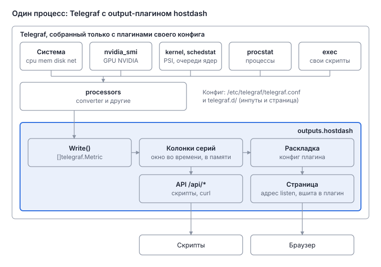

# Telegraf с плагином hostdash: дизайн

Главная дока этой ветки Telegraf. Ветка добавляет к Telegraf два плагина: output-плагин `outputs.hostdash` держит окно метрик в памяти и отдаёт страницу с графиками, инпут `inputs.schedstat` собирает очередь к каждому ядру из `/proc/schedstat`. Конфиги конкретных машин в ветку не входят.

## Доки

| Дока | О чём |
| --- | --- |
| [Дизайн](design.md) | эта: решения, устройство, ветка, рассмотренные варианты, что не сделано |
| [Плагин hostdash](plugin.md) | хранилище, счётчики, статусы, API |
| [Страница](ui.md) | вкладки, секции, строка запроса, графики, Overview, адрес |
| [Производительность](performance.md) | память и цена операций |
| [Инпут schedstat](../../../inputs/schedstat/docs/design.md) | очередь к каждому ядру |

Полное описание конфига плагина — [README hostdash](../README.md), инпута — [README schedstat](../../../inputs/schedstat/README.md), по стандарту README плагинов Telegraf.

## Решения

- Метрики собирает Telegraf, а hostdash — его output-плагин в том же процессе ([Рассмотренные варианты](#рассмотренные-варианты)).
- Ветка начинается от тега стабильного релиза Telegraf, наши изменения лежат коммитами поверх, на новые версии ветка переносится по мере надобности (раздел «Ветка»).
- Наш код — только плагины: `outputs.hostdash` (окно в памяти и страница) и `inputs.schedstat` (очередь к каждому ядру). Куда отдавать данные, hostdash не настраивает: он сам и есть получатель.
- Telegraf можно собрать только с нужными плагинами: штатный `tools/custom_builder` выбирает build tags по конфигам.
- По умолчанию страница показывает каждое поле каждой метрики, которая пришла в `outputs.hostdash`: у каждого поля свой график. Если для measurement описана секция, показывается только то, что в ней описано.
- Раскладка (секции, плитки, графики), единицы, счётчики и проверки задаются в TOML-конфиге `[[outputs.hostdash]]`, в коде их нет. Страница универсальная: вкладки и секции строятся сами.
- Статус есть у секции: `no data` и `errors` берутся от её input-плагина, `warn` и `bad` — от проверок её measurement. Overview перечисляет секции каждой вкладки из конфига: те же названия, тот же порядок и те же ссылки, что на вкладке.
- Плагин получает «no data», если от него нет точки дольше N его интервалов сбора. N настраивается, по умолчанию 3. В коде пока нет (раздел «Не сделано»).
- У секции есть адрес `#<вкладка>/<measurement>`, как якорь заголовка в Markdown.
- Группировка серий в линии — со смыслом PromQL: у блока группировки два режима, `by` (перечисленные теги остаются, остальное сводится; `by ()` — одна линия) и `without` (перечисленные теги убираются). Режим один на блок, переключается кликом; в конфиге секции — `group_by` или `group_without` ([Страница](ui.md#группировка)).
- Страница не опрашивает плагин по таймеру, а ждёт изменений: long polling по ленте `/api/series`, статусы в том же ответе. Ось времени сдвигается по часам страницы, без сети; в фоновой вкладке страница не ждёт и не рисует ([Плагин hostdash](plugin.md#ожидание-изменений), [Страница](ui.md#обновление)).
- Чтобы сбор, пришедший двумя записями, не рисовался по частям, ждущий запрос после записи ждёт ещё `wake_delay` без записей ([Плагин hostdash](plugin.md#ожидание-изменений)).
- Ответы сжимает сам плагин по `Accept-Encoding` (zstd или gzip, обёртка `gzhttp` из `github.com/klauspost/compress`) ([Плагин hostdash](plugin.md#сжатие)).
- Плагин слушает `listen`, по умолчанию `127.0.0.1:9000`. Авторизации и фильтра адресов в плагине нет: кто и как открывает страницу, решает установка.
- Очередь к каждому ядру собирает свой инпут `inputs.schedstat` по стандартам плагинов Telegraf (README, `sample.conf`, тесты, регистрация с build tag), без `inputs.exec` и скриптов ([Инпут schedstat](../../../inputs/schedstat/docs/design.md)).

## Устройство

Метрики идут от инпутов через процессоры и агрегаторы в `outputs.hostdash`; страница и API берут их из окна в памяти того же процесса.

- **Инпуты, процессоры, агрегаторы** — штатные плагины Telegraf и `schedstat`. Конфиг в TOML: другого формата у Telegraf нет, поля конфига в `config/config.go` размечены тегами `toml`.
- **`outputs.hostdash`** — Telegraf вызывает его `Write([]telegraf.Metric)`. Плагин кладёт метрики в окно в памяти и отдаёт страницу и API. HTTP-сервер стартует в `Connect()` и останавливается в `Close()`, как у штатного `outputs.prometheus_client`. Подробно — [Плагин hostdash](plugin.md).
- **Окно живёт на уровне пакета, а не в экземпляре плагина.** При SIGHUP Telegraf внутри того же процесса заново читает конфиг и создаёт агент с новыми плагинами (`reloadLoop` и `runAgent` в `cmd/telegraf/telegraf.go`). Окно переживает перезагрузку конфига, но не перезапуск процесса.
- **Страница** — статические файлы в `plugins/outputs/hostdash/page/`, вшиты через `go:embed`. Линии из серий собирает страница. Подробно — [Страница](ui.md).

## Ветка

- Ветка `master` начинается от тега `v1.40.2` апстрима (`github.com/influxdata/telegraf`). Основа — тег релиза, а не `master` апстрима.
- Наши изменения — два коммита, только новые файлы: `inputs.schedstat` (`plugins/inputs/schedstat/`, `plugins/inputs/all/schedstat.go`) и `outputs.hostdash` (`plugins/outputs/hostdash/`, `plugins/outputs/all/hostdash.go`). Регистрация — с тегом `//go:build !custom || outputs || outputs.hostdash` (и так же у инпута), как у штатных плагинов. Файлы апстрима не меняются, поэтому при переносе конфликтов нет.
- Перенос на новый релиз: `git fetch upstream --tags`, затем `git rebase --onto <новый тег> <старый тег> master`, затем прочитать Important Changes в `CHANGELOG.md` и пересобрать. Fast-forward невозможен: ветка расходится с апстримом с первого нашего коммита.
- Telegraf v1.40.2 требует `go 1.27.0` (`go.mod`).
- Ветка опубликована на GitHub fork'ом апстрима; ветка `master` fork'а — эта ветка, других веток и тегов там нет. Actions в fork'е выключены: workflow апстрима проверяют апстрим, а не наши плагины. После переноса на новый релиз ветка уходит на GitHub через `git push --force-with-lease origin master`.

## Рассмотренные варианты

| Вариант | Почему не он |
| --- | --- |
| Свои сборщики в своём бинаре | переизобретает то, что у Telegraf уже есть |
| Vector | меньше источников для метрик; GPU, сокеты, Wi-Fi и вентилятор пришлось бы снимать своими `exec`-скриптами; VRL не хранит состояние между событиями |
| OpenTelemetry Collector | в `hostmetrics` нет температуры; нет receiver'ов для NVIDIA и `exec` |
| Два процесса: Telegraf шлёт метрики через `outputs.http` в отдельный бинарь | два процесса для одной задачи; в line protocol теряется тип метрики |
| Telegraf как Go-библиотека в своём бинаре | нужен свой `main` вместо штатного CLI с перезагрузкой конфига; стабильность API агента как библиотеки не проверена |
| `outputs.execd`: Telegraf запускает отдельный бинарь (так апстрим советует делать внешние плагины) | перезапуск Telegraf перезапускает и этот бинарь, окно теряется |
| Сведение на сервере: страница шлёт фильтр и группировку секции, сервер отдаёт готовые линии (как Prometheus и Grafana) | линии собирает страница: смена фильтра и группировки мгновенна, без запроса, а на сервере нет кода сведения |

## Не сделано

- «no data» по интервалам сбора: решено, в коде пока правило окна ([Плагин hostdash](plugin.md#статусы)).

## Проверить

- Какие пакеты дают основной объём бинаря (`go tool nm -size` или `goweight`).
- Ловит ли Telegraf панику в инпуте, или она роняет процесс вместе со страницей.
- Хватает ли `wake_delay` 300 мс, чтобы сбор, пришедший двумя записями, рисовался целиком.
- Память и CPU страницы в браузере при нескольких тысячах серий на открытых вкладках.

## Открытые вопросы

Сейчас нет.
